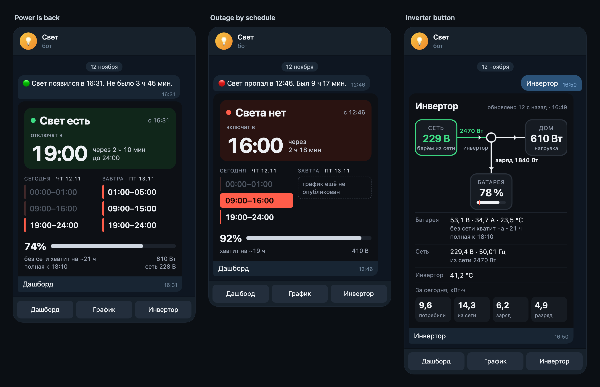
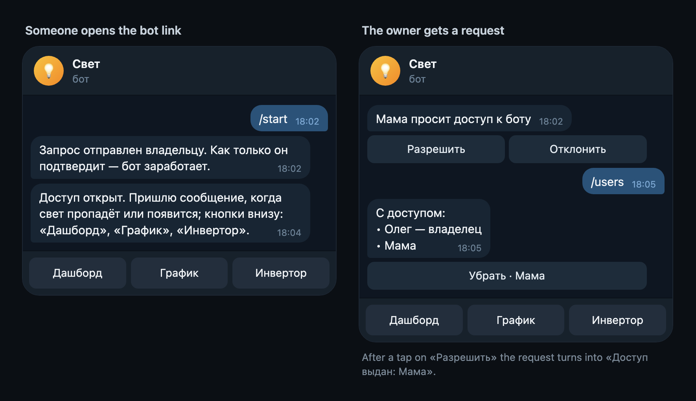
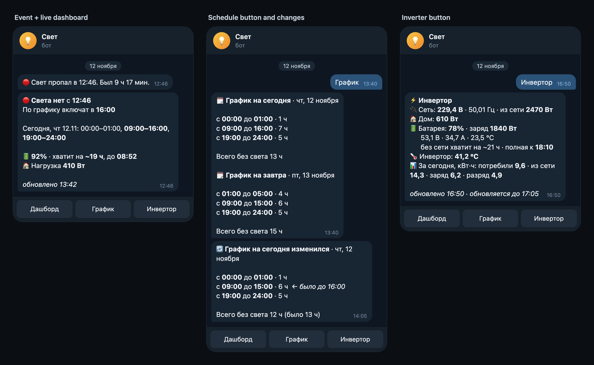
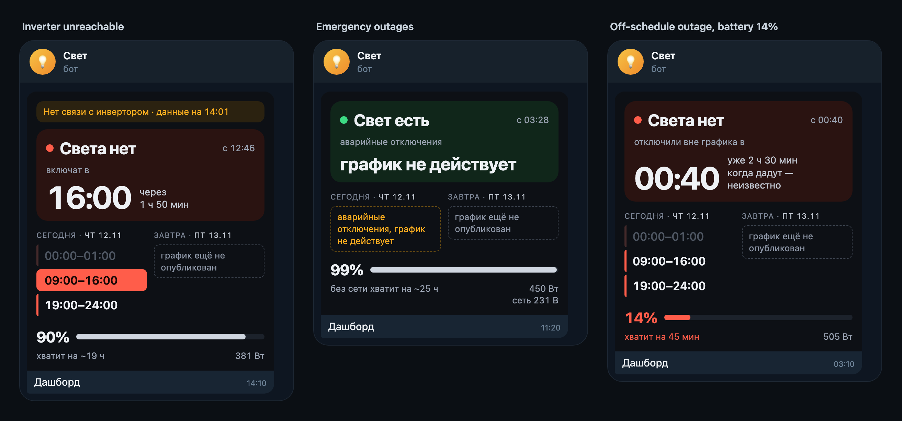

# Svitlo

A Telegram bot that tells my family when the power goes out at our flat in Kyiv and how long the battery will hold.

In Ukraine people say "is there light?" (*чи є світло?*) when they mean electricity, hence the name. Kyiv gets scheduled outages, and the schedule changes during the day. The flat runs on a Deye hybrid inverter with a battery, so when the grid drops nothing goes dark, and nobody notices until the battery runs low. The bot reads the inverter every 10 seconds over the local network and writes to Telegram as soon as grid voltage disappears or comes back.



<sub>How the bot looked with Telegram widgets, before Telegram switched widgets off for bots (see [below](#widgets-and-why-the-bot-currently-sends-text)). All screenshots are rendered by `tools/screenshots.py` from the bot's real widgets and texts, using demo data.</sub>

## What it does

- **🔴 Свет пропал / 🟢 Свет появился.** A message with sound, with the time and how long the previous state lasted. A state change needs two readings in a row (about 20 seconds), so a short voltage dip doesn't wake anyone up.
- **One live dashboard per chat.** Grid on or off, when the next scheduled outage starts or ends, today's and tomorrow's schedule, battery percentage, load, and how long the battery would last at the current load. The bot edits it in place and re-sends it after every event, so it is always the last message in the chat.
- **Schedule messages.** When YASNO publishes tomorrow's schedule, or changes today's, the bot posts the new intervals and marks what moved ("← было до 16:00"). Emergency outages, when the schedule stops applying, get their own message.
- **Inverter button.** A power-flow view: grid, house, battery, with battery voltage, current, temperature and today's kWh counters. It stays live for 15 minutes, then turns into a dated snapshot.
- **Access for family.** Send someone the bot link. They press Start, the owner gets a request with «Разрешить» / «Отклонить», and after approval they get the same messages. `/users` shows who has access and lets the owner revoke it.



## Widgets, and why the bot currently sends text

Bot API 10.4 added widgets: a message that carries a small HTML page, whose data the bot updates with `editMessageWidgetData`. The dashboard (`widgets/a.html`) and the inverter view (`widgets/inverter.html`) were built for that. Telegram caps a widget at 32 KB of HTML, 4 KB after compression and 600 px of height, with no network access; `tools/check_widget.py` checks all of it, and `--render` measures the height in headless Chromium.

On 13 November 2026 Telegram started rejecting `sendWidget` from regular bots with `400 INPUT_MEDIA_WIDGET_NOT_ALLOWED`, even in private chats. Telegram hasn't announced why. The only official word so far is a maintainer's reply in [tdlib/telegram-bot-api#947](https://github.com/tdlib/telegram-bot-api/issues/947): general bots aren't allowed to use widgets at the moment.

The bot handles this by itself. On the first refusal it switches every chat to live text messages with the same data, edited in place under the same rules. Every 30 minutes it tries one widget, and once Telegram accepts it, the text dashboards are silently replaced with widgets again. Right now it looks like this:



The widgets also handled the less common states:



## How it works

```
Deye inverter ──(Solarman V5, TCP 8899, read-only)──► source.py ─┐
YASNO API ─┐                                                       ├─► state.py ──► bot.py ──► Telegram Bot API
outage-data-ua (fallback) ─┴─────────────► schedule.py ───────────┘      │             │
                                                       estimator.py ◄─────┘     storage.py (SQLite)
```

**Reading the inverter.** Deye hybrids ship with a Solarman Wi-Fi logger that answers the Solarman V5 protocol on TCP port 8899 of the local network ([pysolarmanv5](https://github.com/jmccrohan/pysolarmanv5)). The bot keeps one connection open and reads holding registers 150–219 every 10 seconds: grid voltage, load, battery charge and power, the shutdown threshold. Daily kWh counters, grid frequency and inverter temperature (registers 60–91) are read every 5 minutes, or every 30 seconds while someone has the inverter view open. The bot never writes to the inverter, and the code has no write call.

**Grid state.** Grid voltage of 170 V or more means power is on. If the logger stops answering, the bot doesn't call that an outage: it sends nothing, and the dashboard says «нет связи с инвертором» with the time of the last good reading.

**Battery forecast.** Without grid: time until the battery reaches the inverter's shutdown threshold (register 217). Battery power is smoothed (median of three readings, then an exponential average over about 12 minutes), so a kettle doesn't swing the forecast, while a lasting change in load shows up within 10–20 minutes. With grid: time to 100%, using how many seconds 1% of charge actually took for this battery in each 5% band. `python -m svitlo accuracy` compares past forecasts with what happened. On 12 November 2026 the measured discharge rate was within 4% of what the battery's rated capacity predicts.

**Delivery.** Every subscriber's progress through "event → delete old dashboard → send new dashboard" is written to SQLite step by step, so a restart or a network error in the middle doesn't lose an event or send it twice. Telegram only lets a bot delete its own message within 48 hours, so dashboards older than 47 hours are re-sent quietly.

The full bot ↔ widget contract (in Russian) is in [`docs/contract.md`](docs/contract.md).

## Running your own

You need:

- a Deye **single-phase** hybrid inverter with a Solarman Wi-Fi logger. I've only run it on one inverter. Three-phase models use a different register map, so `svitlo/source.py` would need changes;
- a machine that can reach the logger: a Raspberry Pi or any always-on computer at home, or a server with a VPN tunnel into the home network;
- Python 3.9+ and a bot token from [@BotFather](https://t.me/BotFather).

The schedule comes from YASNO, which covers Kyiv. Outside Kyiv you'd have to write another fetcher in `svitlo/schedule.py`.

```bash
git clone https://github.com/nikitovih2004-ui/svitlo.git && cd svitlo
python3 -m venv .venv && .venv/bin/pip install -r requirements-dev.txt
cp .env.example .env && chmod 600 .env
# fill in BOT_TOKEN, ALLOWED_IDS, LOGGER_HOST, LOGGER_SERIAL, GROUP, BATTERY_KWH
.venv/bin/python -m svitlo probe   # reads the inverter and the schedule once, no Telegram involved
.venv/bin/python -m svitlo         # starts the bot
```

If you don't know your Telegram id, leave `ALLOWED_IDS` empty, start the bot and message it: it will reply with your id. The first id in `ALLOWED_IDS` is the owner, who approves everyone else.

Other commands:

| command | |
|---|---|
| `python -m svitlo demo` | a sped-up scenario on a fake inverter (charge, a false dip, an outage, lost connection, restart, power back) that prints the Bot API calls instead of sending them |
| `python -m svitlo accuracy` | how far the "battery lasts until" forecast was from reality (`--current` includes an outage in progress) |
| `python -m pytest` | 184 tests |
| `python tools/check_widget.py --render` | widget size and height limits |
| `python tools/screenshots.py` | regenerates the images in this README |

All settings are in [`.env.example`](.env.example) with comments.

### Deploying

`deploy/svitlo.service` is a hardened systemd unit with install steps in its header; `deploy/deploy.sh` syncs the code to a server and restarts it. There is also a `deploy/Dockerfile`.

Two practical notes:

- If the bot runs outside your home network, the server has to reach the logger somehow. My home connection sits behind the provider's NAT, so the server can't connect in. Instead the home router (with a WireGuard VPN client) connects out to the server, and only the logger's traffic goes through that tunnel. Nothing else at home is routed through it.
- During an outage the router and whatever runs the bot need power too. If they aren't on the inverter or a UPS, the message about the outage arrives when the power is already back.

## Language

The bot speaks Russian. Every text it sends is in `svitlo/texts.py`, so translating it means editing that one file. Code comments are in Russian too.

## License

[MIT](LICENSE)
